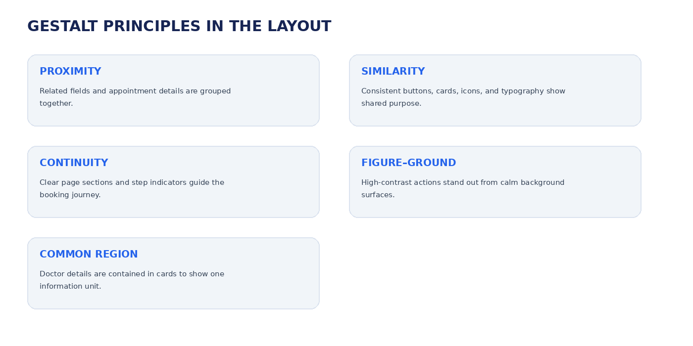
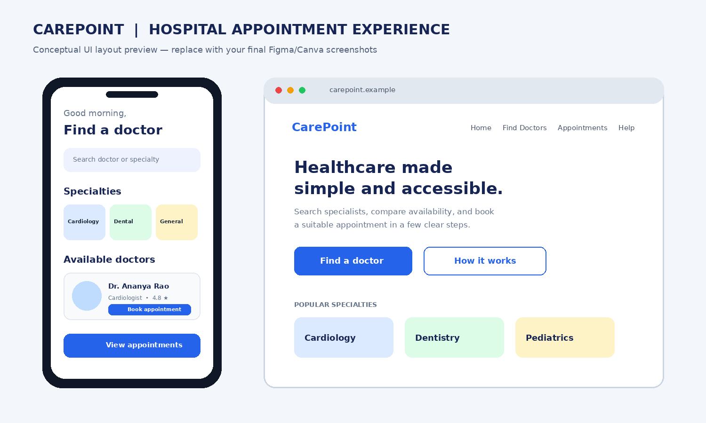

# Experiment: Basic Mobile and Web Layout Design Using an Existing Case Study

> **Case study used:** Hospital appointment booking system (CarePoint — conceptual sample brand).  
> Replace the sample brand, content, and preview images with your own final design screenshots if your class case study is different.

## 1. Aim

To design basic mobile and web layouts for an existing case study by applying Gestalt principles, suitable UI elements and design patterns, interaction behaviors, usability principles, and a consistent brand identity.

## 2. Objectives

- Apply Gestalt principles to organize content and improve visual understanding.
- Create consistent mobile and web layouts for the same user task.
- Use familiar UI elements and design patterns.
- Define interactions that make the interface predictable and easy to use.
- Create a simple brand logo in Canva and apply consistent branding guidelines.

## 3. Case Study Overview

**Problem:** Patients may find it difficult to understand doctor availability, compare appointment options, and complete a booking without confusion.

**Proposed solution:** CarePoint provides a clear way to search for a doctor or specialty, review available appointment information, and book an appointment.

**Primary users:** Patients and caregivers who need to find and book hospital appointments.

**Main user goal:** Find a suitable doctor and book an available appointment with minimal effort.

## 4. Information Architecture

1. Home
2. Find a Doctor
   - Search by doctor name
   - Browse by specialty
   - View doctor profile
3. Appointment Booking
   - Select date
   - Select available time
   - Enter patient details
   - Review and confirm
4. My Appointments
   - Upcoming appointments
   - Reschedule or cancel
5. Help and Contact

## 5. Gestalt Principles Applied

| Principle | Application |
|---|---|
| Proximity | Related search fields, doctor details, and appointment information are grouped together. |
| Similarity | Buttons, cards, icons, and typography use consistent visual styles. |
| Continuity | Headings, section order, and booking steps guide users through the task. |
| Figure–Ground | Primary actions use clear contrast against the page background. |
| Common Region | Doctor information and appointment choices are placed inside separate cards. |
| Prägnanz (Simplicity) | Unnecessary decoration is avoided so users can focus on essential information. |

## 6. UI Elements and Design Patterns

- **Navigation:** Bottom navigation on mobile; top navigation on web.
- **Search:** Search field with a clear placeholder and search icon.
- **Cards:** Doctor cards display name, specialty, rating, and availability.
- **Buttons:** Primary button for “Book appointment”; secondary button for less important actions.
- **Forms:** Clearly labelled fields with suitable input types.
- **Feedback:** Success message after booking and inline validation for incomplete fields.
- **Status indicators:** Text labels such as “Available”, “Booked”, and “Cancelled”; do not rely on color alone.
- **Responsive layout:** Content changes from a single-column mobile layout to a wider multi-column web layout.

## 7. Interaction Behaviors

| UI element | User action | Expected system response |
|---|---|---|
| Search field | Enters doctor name or specialty | Shows matching results or a helpful empty state |
| Specialty card | Selects a specialty | Displays doctors in that specialty |
| Doctor card | Selects “View details” | Opens the doctor profile |
| Date selector | Chooses a date | Displays available time slots |
| Time slot | Selects a slot | Shows the selected slot clearly |
| Booking form | Submits incomplete details | Shows specific validation messages |
| Confirm button | Confirms the booking | Displays confirmation and appointment summary |
| Navigation item | Selects a section | Opens the corresponding page or view |

## 8. Usability Principles

1. **Visibility of system status:** Show loading, selected time, and booking confirmation.
2. **Consistency:** Keep labels, buttons, colors, and navigation patterns consistent.
3. **Error prevention:** Disable unavailable time slots and validate required fields.
4. **Recognition rather than recall:** Show clear labels and available choices instead of asking users to remember information.
5. **User control:** Provide clear back, edit, reschedule, and cancel actions.
6. **Accessibility:** Use readable text, sufficient contrast, descriptive labels, and touch-friendly controls.
7. **Responsive design:** Ensure the layout works on small and large screens.

## 9. Mobile and Web Layout Preview

The following image is a **conceptual layout reference**, not a final screenshot of a coded application. Replace it with screenshots exported from your completed Figma design.

### Mobile layout

- Single-column content.
- Search and specialty choices near the top.
- Doctor information displayed as stacked cards.
- Large, easy-to-tap primary action.
- Bottom navigation for key sections.

### Web layout

- Top navigation with clear page links.
- Wider hero section with a primary call to action.
- Specialty cards arranged in a row or grid.
- Doctor results displayed in a wider content area.
- Consistent spacing and alignment.

## 10. Brand Identity and Canva Logo

**Sample brand name:** CarePoint  
**Tagline:** “Care made easier.”

### Suggested brand guidelines

| Item | Suggested style |
|---|---|
| Primary color | Blue `#2563EB` |
| Secondary color | Light blue `#DBEAFE` |
| Background | White `#FFFFFF` |
| Main text | Deep navy `#172554` |
| Supporting text | Slate `#64748B` |
| Heading font | Poppins or a similar sans-serif |
| Body font | Inter or a similar sans-serif |

### Canva logo creation steps

1. Open Canva and create a square logo design.
2. Use a simple healthcare symbol such as a medical cross combined with a location pin or heart.
3. Add the brand name **CarePoint** using a readable sans-serif font.
4. Apply the primary blue and keep the background transparent or white.
5. Keep the logo simple so it remains recognizable at small sizes.
6. Export the logo as a PNG with a transparent background.
7. Save it as `carepoint-logo.png` in this repository.

## 13. Result

Basic mobile and web layouts were planned for the selected case study. Gestalt principles, common UI elements, design patterns, interaction behaviors, usability guidelines, and branding recommendations were incorporated into the design process.

report before submitting.
